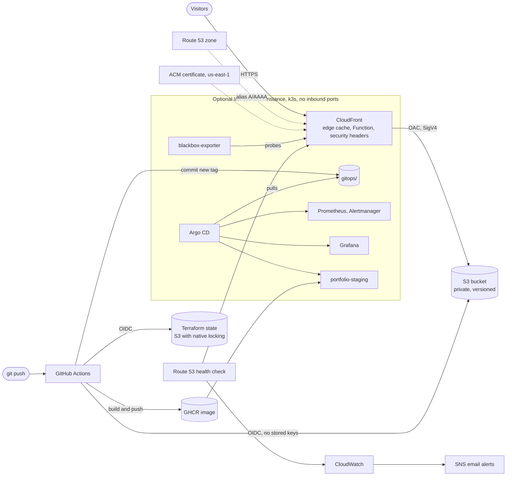

# Infrastructure

Terraform, GitHub Actions and Kubernetes manifests for the AWS hosting option of aldwinsamson.com, plus an optional k3s observability lab.

## Architecture



The public site never depends on the lab. The lab can be stopped or destroyed without affecting visitors.

| Concern | Approach |
| --- | --- |
| Availability | CloudFront in front of S3; no servers to patch |
| Security | Private bucket with origin access control, TLS 1.2+, HSTS, CSP, OIDC instead of static keys, least-privilege deploy role, IMDSv2, SSM-only access to the lab |
| Delivery | Pull request, CI, merge, build, upload assets first and `index.html` last, invalidate, smoke test |
| Rollback | Re-run the deploy workflow with an older commit SHA; S3 versioning is a second safeguard |
| GitOps | `container.yml` commits the new image tag; Argo CD reconciles the cluster from Git (self-heal and prune) |
| Observability | CloudWatch alarms and dashboard, SNS email alerts, Prometheus and Grafana in the lab, budget alerts |

## Cost

Figures are approximate list prices for `ap-southeast-1`. Verify them with the AWS Pricing Calculator and Cost Explorer.

| Item | Monthly |
| --- | --- |
| S3, CloudFront (within free allowance), ACM, SNS, CloudWatch, Budgets | about $0 to $1 |
| Route 53 hosted zone | $0.50 |
| Route 53 health check (HTTPS) | about $1.75 |
| **Production total, lab off** | **about $3** |
| Lab: `t4g.small` on a schedule, 30 GB volume, public IPv4 | about $15 to $16 |
| **Production and lab** | **about $18 to $20** |

No NAT gateway or EKS control plane is used; each would dominate the bill. k3s demonstrates the same GitOps and monitoring workflow at a fraction of the cost.

Accounts on the AWS Free plan are closed after six months or when credits are exhausted unless upgraded to a paid plan. Only some EC2 types are permitted on that plan (`t3.micro`, `t3.small`, `t4g.micro`, `t4g.small`, `c7i-flex.large`, `m7i-flex.large`).

## Runbook

### Prerequisites

- AWS account with MFA, operated through IAM Identity Center or an IAM admin user (never root credentials); `aws configure sso`
- AWS CLI v2, Session Manager plugin, Terraform 1.10 or later (or OpenTofu), GitHub CLI, Node 22
- A public repository, because Argo CD reads `gitops/` anonymously and the GHCR image is pulled anonymously. If the repository is renamed, update `github_repository` in `terraform/environment.tfvars`, the `repoURL` values in `gitops/apps/`, and the image name in `gitops/manifests/portfolio/`.
- A registered domain

### 1. Bootstrap (local, once)

Creates the state bucket, DNS zone, OIDC roles and budget.

```bash
cd infra/terraform/bootstrap
terraform init
terraform apply -var-file=../environment.tfvars -var-file=bootstrap.tfvars
```

Outputs include `name_servers`, the state bucket, role ARNs and the `gh variable set` commands for step 3. The bootstrap state is local by default; back it up or migrate it to the S3 backend with `terraform init -migrate-state`. Never commit state.

### 2. Delegate DNS

At the registrar, set the four `name_servers` values, then verify:

```bash
dig NS aldwinsamson.com +short
```

The production apply waits for certificate validation, which succeeds only after delegation.

### 3. Configure GitHub

- Run the `gh variable set ...` commands printed by the bootstrap output.
- Create an environment named `production` with required reviewers.
- Grant workflows read and write permission (Settings, Actions, General); `container.yml` needs it to commit the image tag.

### 4. First production apply (local)

```bash
cd infra/terraform/environments/prod
terraform init -backend-config="bucket=<state bucket from bootstrap>"
terraform plan  -var-file=../../environment.tfvars -var-file=prod.tfvars
terraform apply -var-file=../../environment.tfvars -var-file=prod.tfvars
```

Allow 10 to 20 minutes for certificate validation and the CloudFront deployment. Then run the `gh variable set ...` commands from the `github_variables_commands` output, confirm the SNS subscription email, and commit the generated `.terraform.lock.hcl` files.

### 5. First site deployment

Run the **Deploy to AWS (manual)** workflow. It builds, uploads, invalidates the cache and smoke-tests the CloudFront address.

### 6. Content Security Policy

`site.csp.mode` ships as `report-only`. Browse every page in both themes with DevTools open; if no violations are reported, set `mode = "enforce"` in `environments/prod/prod.tfvars` through a pull request. Add any reported host to `site.csp.img_hosts`, `style_hosts`, `font_hosts` or `connect_hosts`.

### 7. Observability lab (optional)

1. Run `container.yml` once, then set the GHCR package visibility to public.
2. Set `lab.enabled = true` in `environments/prod/prod.tfvars`, then apply through a pull request or locally.
3. Allow 8 to 12 minutes for first boot; follow progress with the `shell` and `bootstrap_log` commands from `terraform output lab`.
4. Open Argo CD, Grafana, Prometheus and staging through the printed `aws ssm start-session` port-forward commands. Admin passwords are retrieved with the `argocd_password` and `grafana_password` commands.
5. In Argo CD, `root`, `kube-prometheus-stack`, `blackbox-exporter`, `monitoring-config` and `portfolio-staging` should be Healthy and Synced.

The lab stops at 23:00 and starts at 07:00 Asia/Manila (`lab.schedule`). Prometheus data persists on the volume.

## Operations

| Task | Procedure |
| --- | --- |
| Change infrastructure | Edit `infra/terraform/**` in a pull request, review the plan comment, merge, approve the apply |
| Roll back the site | Run **Deploy to AWS (manual)** with `ref` set to an older commit SHA |
| Pause lab costs | Set `lab.enabled = false`, or stop the instance (only the volume is then billed) |
| Recover the lab | `terraform apply`; Argo CD restores every application from `gitops/` |
| Tear down | Disable the lab; for production, empty the site bucket and `terraform destroy`. Bootstrap resources have `prevent_destroy`. |

## Known limits

- No WAF, access logging, cross-region origin failover, KMS customer-managed keys or DNSSEC. Each skipped Checkov control is documented with its reason in `.checkov.yaml`.
- The Terraform apply role is `PowerUserAccess` plus IAM for `aldwinsamson-*` resources. Because it can create IAM roles it is effectively administrative; the control that matters is the OIDC `sub` claim pinned to the `production` environment with required reviewers.
- Alertmanager has no outbound receiver, to keep secrets out of Git. Email alerting for the public site comes from CloudWatch through SNS.
- The optional `chat-api` Terraform module (Lambda and API Gateway) still expects an Anthropic key in SSM, whereas the Vercel function uses Gemini. Keep `chat.enabled = false` until the module is updated.

## Troubleshooting

| Symptom | Cause and fix |
| --- | --- |
| Apply hangs on `aws_acm_certificate_validation` | Name servers not delegated yet. Check with `dig NS`; the apply resumes on its own (75 minute timeout). |
| `AccessDenied` when creating a resource on the Free plan | The service or instance type is restricted. Upgrade the plan or choose an allowed type. |
| Site returns XML `AccessDenied` or 403 | The bucket is empty. Run the deploy workflow. |
| `Not authorized to perform sts:AssumeRoleWithWebIdentity` | `github_repository` mismatch (case-sensitive) or the workflow ran from a branch other than `main`. |
| Lab applications `OutOfSync` or `ImagePullBackOff` | The GHCR package is not public, or `container.yml` has not yet pushed a tag. |
| Prometheus `OOMKilled` | Instance too small. Raise `lab.instance_type` and `limits.memory` in `gitops/values/kube-prometheus-stack.yaml`. |
| CSP violations after `enforce` | Add the host to the matching `site.csp.*_hosts` list in `prod.tfvars`. |

## Terraform layout

Modules are generic and contain no project-specific values. One shared file, [`terraform/environment.tfvars`](terraform/environment.tfvars), supplies project, environment, region, domain, repository and alert address; each stack adds its own small variables file.

```
terraform/
  environment.tfvars      Shared values
  bootstrap/              State bucket, DNS zone, GitHub OIDC and CI roles, budget (applied once, locally)
  environments/prod/      Composition of modules; prod.tfvars holds site, monitoring, lab, hosting and chat settings
  modules/
    secure-s3-bucket/     Private, encrypted, versioned bucket with a TLS-only policy
    static-site/          S3, CloudFront (OAC, edge Function, security headers), ACM, Route 53 records
    monitoring/           SNS alerts, health check, CloudWatch alarms and dashboard
    github-oidc-role/     IAM role for GitHub Actions with trust pinned to exact `sub` values
    budget-alerts/        AWS Budgets thresholds
    k3s-lab/              VPC and SSM-only EC2 running k3s and Argo CD
    instance-scheduler/   EventBridge Scheduler start and stop
    chat-api/             Optional Lambda and API Gateway for the assistant
```

Names and tags derive from a shared `context` object (`project`, `environment`, `region`, `prefix`, `tags`), so resources follow the pattern `<project>-<environment>-<purpose>` and carry `Project`, `Environment`, `Owner`, `Repository` and `ManagedBy` tags.

| To change | Edit |
| --- | --- |
| Domain, region, repository, alert email, names | `terraform/environment.tfvars` |
| CSP hosts, price class, www redirect | `site` in `environments/prod/prod.tfvars` |
| Uptime check, alarm threshold | `monitoring` |
| Lab size, schedule, on or off | `lab` |
| Where the domain points | `hosting.target` (`aws` or `vercel`) |

### Adding an environment

1. Copy `environments/prod` to `environments/<name>` and change the state key in `versions.tf`.
2. Copy `environment.tfvars` with a new `environment` and `domain_name`, then adjust the new stack's variables file.
3. In `bootstrap/bootstrap.tfvars`, add the name to `additional_environments` and `github_environments`, re-apply bootstrap, and create the matching GitHub environment with required reviewers.

No module changes are required.

## Other directories

```
gitops/apps/        Argo CD applications (app-of-apps; root is created by the first-boot script)
gitops/values/      Helm values for kube-prometheus-stack
gitops/manifests/   Kustomize bases and overlays: portfolio (staging) and monitoring
.github/workflows/  ci, codeql, terraform, deploy, container
scripts/            smoke-test.sh, generate-sitemap.mjs, new-project.mjs
```
