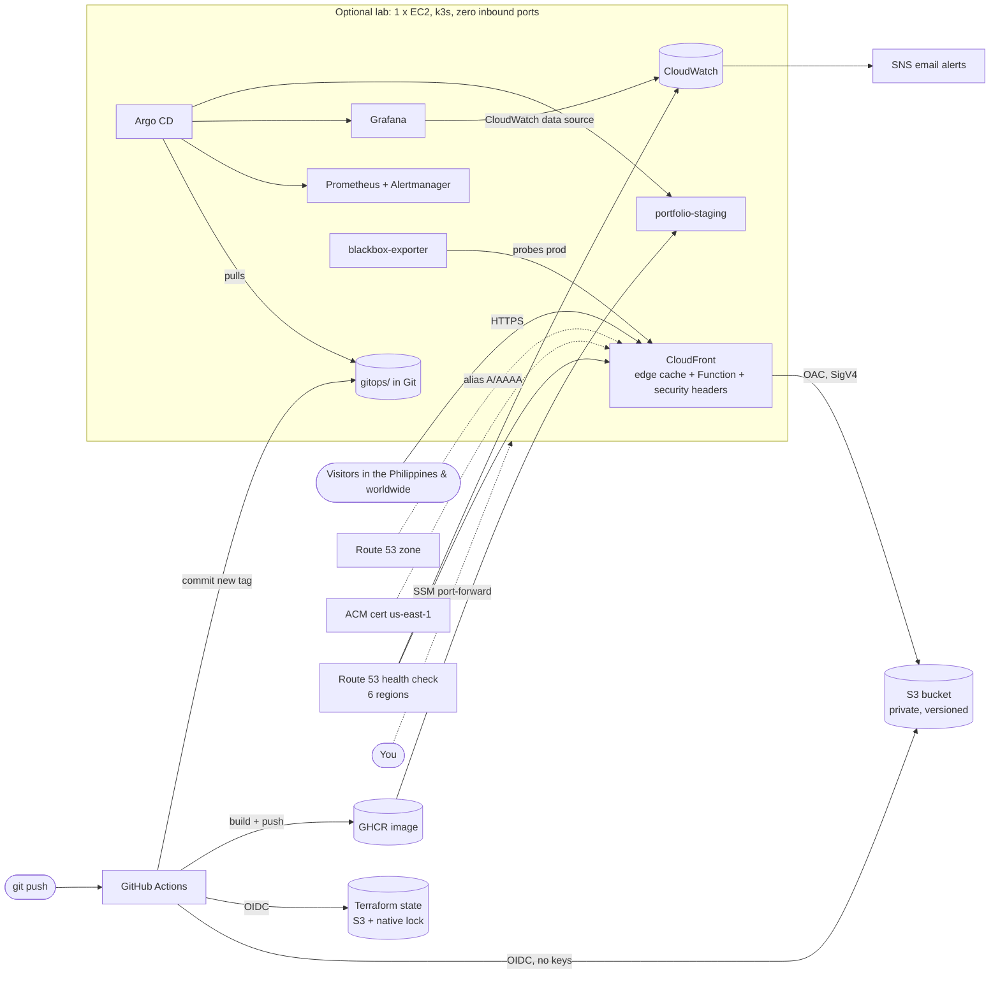

# Infrastructure & DevOps runbook — aldwinsamson.com

Everything that runs the portfolio is code in this repository: **Terraform** (AWS), **GitHub Actions**
(CI/CD, OIDC to AWS), **Argo CD + Prometheus + Grafana** on a small k3s lab (GitOps + observability).

## 1. Architecture



**Design rule: the public website never depends on the lab.** The site is S3 + CloudFront only.
The k3s lab is an optional showcase that can be stopped or destroyed without affecting visitors.

| Concern | How it is handled |
|---|---|
| Availability | CloudFront (global edge incl. Manila, `PriceClass_All`) in front of S3 (multi-AZ). No server to patch or crash. |
| Security | Private bucket + OAC, TLS 1.2+, HSTS, CSP, no static AWS keys (OIDC), least-privilege deploy role, IMDSv2, no SSH / no inbound ports (SSM only). |
| Delivery | PR -> CI (typecheck, tests, audit, Checkov, manifests) -> merge -> build -> S3 (assets first, `index.html` last) -> invalidate -> smoke test. |
| Rollback | Re-run **Deploy site** with an older commit SHA (S3 versioning is a second safety net). |
| GitOps | `container.yml` commits the new image tag; Argo CD reconciles the cluster from Git (self-heal + prune). |
| Observability | CloudWatch dashboard + alarms (5xx, uptime) -> SNS email; Prometheus/Grafana in the lab; budget alerts. |

## 2. Cost & the Free-plan clock (read this first)

AWS's new Free plan gives credits instead of the old 12-month free tier. As of my research (Oct 2026):

* The Free plan **ends after 6 months or when the credits are used up — whichever comes first**, and the
  account is then **closed unless you upgrade to a Paid plan** (a short grace period exists). A closed account =
  your website goes down. **Upgrade to the Paid plan well before month 6** (Billing -> account plan). Unused credits
  are kept after upgrading and stay valid until their own expiry (up to 12 months after sign-up).
* On the Free plan only some EC2 types are allowed: `t3.micro`, `t3.small`, `t4g.micro`, `t4g.small`,
  `c7i-flex.large`, `m7i-flex.large`. The lab defaults to `t4g.small`.
* CloudFront has a monthly always-free allowance (1 TB / 10 M requests when I checked) — a portfolio stays inside it.
* The domain is bought separately; Route 53 only hosts DNS ($0.50/month per zone, **not** covered after credits).

Rough monthly estimate (Singapore region; **ballpark from public price lists — check the AWS Pricing Calculator and
Cost Explorer after 3 days**):

| Item | Approx. / month |
|---|---|
| S3, CloudFront (within free allowance), ACM, SNS, CloudWatch (free tier), Budgets | ~ $0–1 |
| Route 53 hosted zone | $0.50 |
| Route 53 health check (HTTPS) | ~ $1.75 |
| **Production total (lab off)** | **~ $3** |
| Lab: t4g.small, 16 h/day (schedule) | ~ $10 |
| Lab: 30 GB gp3 volume | ~ $3 |
| Lab: public IPv4 while running | ~ $2.5 |
| **Production + lab** | **~ $18–20** |

With the lab on, $120 lasts roughly 5–6 months; with only production it lasts years. A NAT gateway (~$32/month) and an
EKS control plane (~$73/month) are deliberately **not** used — either would burn the credit in weeks.
Why k3s and not EKS: the point is to demonstrate Argo CD/Prometheus/GitOps skills; a $73/month control plane adds no extra skill for a static site.

## 3. Step-by-step runbook

### 0. Prerequisites (once)
* AWS account **with MFA**; do the work as an IAM Identity Center / IAM admin user — **never root keys**. Configure `aws configure sso`.
* Tools: AWS CLI v2, [Session Manager plugin](https://docs.aws.amazon.com/systems-manager/latest/userguide/session-manager-working-with-install-plugin.html), Terraform >= 1.10 (or OpenTofu), GitHub CLI (`gh auth login`), Node 22.
* The repo `aldwinsamson/Aldwin_Samson_Portfolio` must be **public** (Argo CD reads `gitops/` without credentials; GHCR image is pulled anonymously).
  If you rename the repo, update `github_repository` / `gitops_repo_url` in both `*.tfvars`, the three `repoURL`s in `gitops/apps/`, and the image name in `gitops/manifests/portfolio/`.

### 1. Buy the domain
Buy `aldwinsamson.com` at any registrar. Do not change anything there yet.

### 2. Bootstrap (local, once) — state bucket, DNS zone, OIDC roles, budget
```bash
cd infra/terraform/bootstrap
terraform init
terraform apply -var-file=bootstrap.tfvars
```
Outputs: `name_servers`, the state bucket, role ARNs and ready-made `gh variable set ...` commands.
Back up this stack's local `terraform.tfstate` (or migrate it: add a `backend "s3"` block pointing at the new bucket with key `bootstrap/terraform.tfstate`, then `terraform init -migrate-state`). Never commit state.

### 3. Delegate DNS
At the registrar, replace the nameservers with the 4 values from `name_servers`. Verify (can take minutes to hours):
```bash
dig NS aldwinsamson.com +short
```
The production apply waits for the TLS certificate, which only validates once delegation works.

### 4. GitHub setup
```bash
gh variable set ...            # the 4 commands printed by the bootstrap output
```
GitHub -> Settings -> Environments -> **New environment `production`** -> add yourself under *Required reviewers*.
Settings -> Actions -> General -> allow workflows read/write permission (needed by `container.yml` to commit the tag).

### 5. First production apply (local)
```bash
cd infra/terraform/prod
terraform init -backend-config="bucket=<state_bucket from step 2>"
terraform plan  -var-file=prod.tfvars
terraform apply -var-file=prod.tfvars     # ~10-20 min: certificate validation + CloudFront deployment
```
Then run the `gh variable set ...` commands from the new `github_variables_commands` output.
Click the **SNS subscription confirmation** email AWS sends, or no alert will ever reach you.
Commit the generated `.terraform.lock.hcl` files (they pin provider versions).

### 6. First site deployment
Actions -> **Deploy site** -> *Run workflow*. It builds, uploads, invalidates, then smoke-tests `https://aldwinsamson.com`.
From now on every push to `main` that changes the site deploys automatically.

### 7. Turn the CSP on (after checking it)
`csp_mode = "report-only"` ships first so nothing can break. Open the live site, DevTools -> Console, visit every page in light and dark theme.
If no `Content-Security-Policy-Report-Only` violations appear, change `csp_mode = "enforce"` in `prod.tfvars` in a PR; the *Terraform* workflow comments the plan, and merging runs `apply` after your approval. If something is reported, add the host to `csp_img_hosts` (or tell me what is blocked).

### 8. The DevOps lab (when you want ArgoCD / Prometheus / Grafana)
1. Merge once so `container.yml` publishes the image, then GitHub -> your profile -> Packages -> the image -> *Package settings* -> **Change visibility: Public**.
2. Set `enable_lab = true` in `prod.tfvars` (PR -> merge -> approve), or run `terraform apply -var-file=prod.tfvars` locally.
3. Wait ~8-12 min for first boot. Follow it with the `shell` + `bootstrap_log` commands from `terraform output lab`.
4. Open Argo CD / Grafana / Prometheus / staging through the printed `aws ssm start-session ...` port-forward commands
   (no inbound ports exist). Passwords: the `argocd_password` / `grafana_password` commands.
5. In Argo CD you should see `root` -> `kube-prometheus-stack`, `blackbox-exporter`, `monitoring-config`, `portfolio-staging` all *Healthy/Synced*.
6. The lab stops at 23:00 and starts at 07:00 Manila time (`lab_schedule_enabled`). Prometheus data survives (volume), IPs do not matter (SSM).

### 9. Before month 6
Upgrade the AWS account to the **Paid plan**. Keep the budget alerts. Consider `terraform destroy` of the lab (`enable_lab = false`) if you are done showcasing it.

## 4. Day-2 operations

| Task | How |
|---|---|
| Change infrastructure | Edit `infra/terraform/**` in a PR -> review the plan comment -> merge -> approve apply. |
| Roll the site back | Actions -> *Deploy site* -> Run workflow -> `ref` = old commit SHA. |
| Prune old hashed bundles | `aws s3 ls s3://<bucket>/assets/` and delete old ones (they cost fractions of a cent; do this rarely). |
| Stop paying for the lab now | `enable_lab = false` (or just stop the instance in the console: you then pay only for the volume). |
| Break-glass | Everything is re-creatable from Git. Site: re-run Deploy. Lab: `terraform apply` re-bootstraps it; Argo CD restores every app from `gitops/`. |
| Tear everything down | Lab: `enable_lab = false`. Prod: `terraform destroy` (empty the site bucket first). Bootstrap resources have `prevent_destroy`. |

## 5. Known limits & what is intentionally not included

* **No WAF, no access logs, no cross-region origin failover, no KMS CMKs, no DNSSEC** — each costs money or complexity that a static portfolio doesn't need. Each skip is documented in `.checkov.yaml` so they are conscious decisions, not oversights.
* The Terraform *apply* role is `PowerUserAccess` + IAM for `aldwinsamson-*` names. Anything that can create IAM roles is effectively admin; the real protection is the OIDC `sub` pinned to the `production` environment with a required reviewer.
* Alertmanager has no outbound receiver (no secrets in Git). Real-time email alerting for the public site comes from CloudWatch -> SNS; Prometheus alerts are visible in Alertmanager/Grafana.
* Not verified in the environment that produced this code (no AWS account or browser available): `terraform plan/apply`, the k3s first boot on Amazon Linux 2023, the CSP in a real browser, and the Grafana CloudFront panel. Expect to fix small things on the first run; static validation (formatting, reference checks, Checkov, actionlint, kubeconform, shellcheck) all pass.

## 6. Troubleshooting

| Symptom | Cause / fix |
|---|---|
| `terraform apply` hangs on `aws_acm_certificate_validation` | Name servers not delegated yet. `dig NS aldwinsamson.com`; fix at the registrar; it continues by itself (timeout 75 min). |
| `AccessDenied` creating a service on the Free plan | Some services/types are restricted on the Free plan. Upgrade to the Paid plan (credits still apply) or pick an allowed type. |
| Site shows XML `AccessDenied` / 403 | Nothing deployed yet (empty bucket). Run *Deploy site*. |
| Deploy: `Not authorized to perform sts:AssumeRoleWithWebIdentity` | `github_repository` mismatch (case-sensitive), or the workflow ran from a branch other than `main`. |
| Lab apps `OutOfSync` / `ImagePullBackOff` | GHCR package not public yet, or `container.yml` hasn't pushed a tag yet (`newTag: latest` placeholder). |
| Prometheus OOMKilled | Node too small: raise `lab_instance_type` (e.g. `c7i-flex.large`, 4 GiB — Free-plan eligible) and `limits.memory` in `gitops/values/kube-prometheus-stack.yaml`. |
| Console says CSP violation after `enforce` | Add the host to `csp_img_hosts` (images) or extend `local.csp` in `modules/static-site/cloudfront.tf`. |

## 7. File map

```
infra/terraform/bootstrap/   state bucket, Route 53 zone, GitHub OIDC provider + plan/apply roles, budget
infra/terraform/prod/        root stack: static_site + monitoring (+ k3s_lab) + least-privilege site-deploy role
infra/terraform/modules/
  static-site/               S3, CloudFront (OAC, Function, headers policy), ACM, DNS records
  monitoring/                SNS, Route 53 health check, CloudWatch alarms + dashboard
  k3s-lab/                   VPC, EC2 (SSM only), IAM, EventBridge start/stop schedule, first-boot script
gitops/apps/                 Argo CD child Applications (app-of-apps; "root" is created by the first-boot script)
gitops/values/               Helm values (lean kube-prometheus-stack)
gitops/manifests/            Kustomize: portfolio (staging) and monitoring (probes, rules, dashboard)
.github/workflows/           ci, deploy, terraform, container, codeql   (+ dependabot.yml)
scripts/smoke-test.sh        post-deploy checks
```
